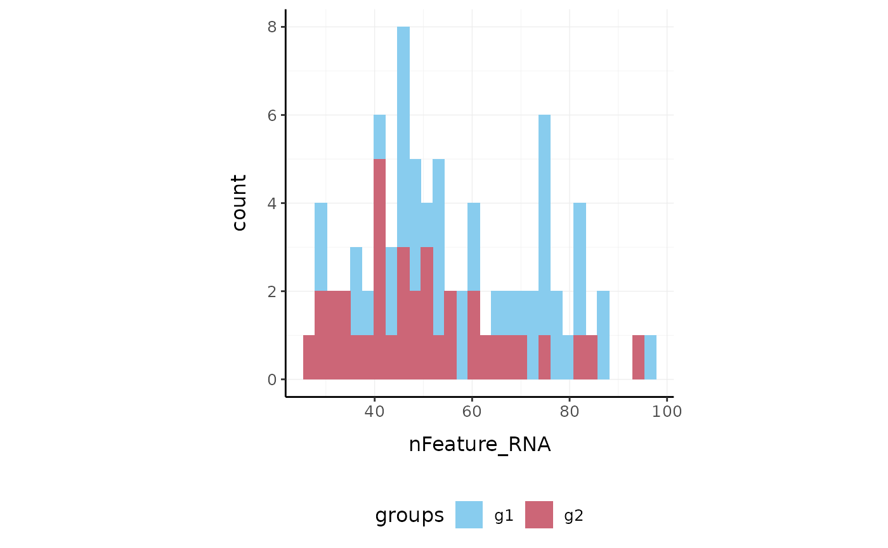
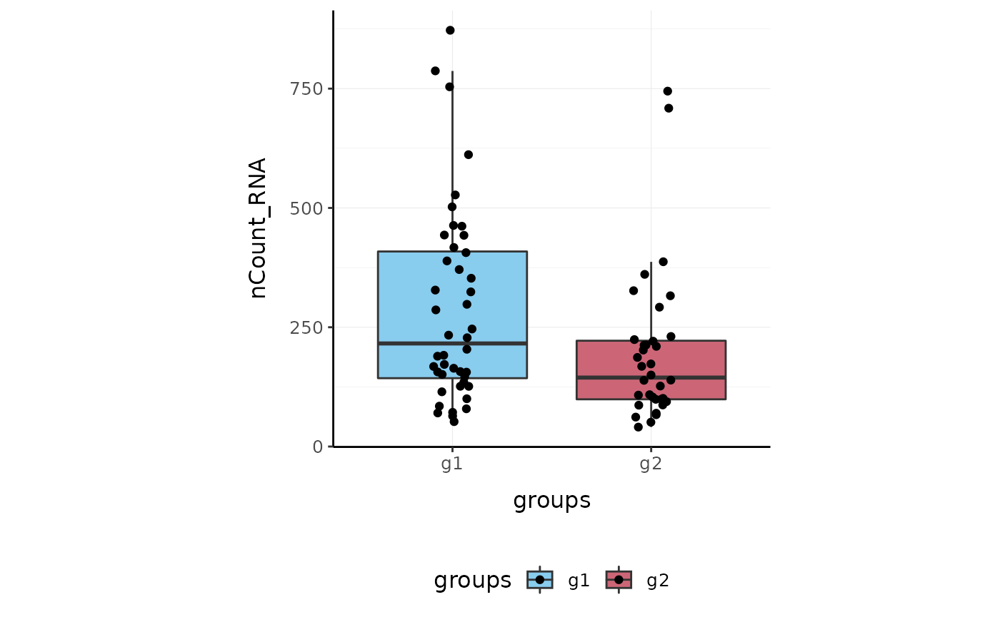
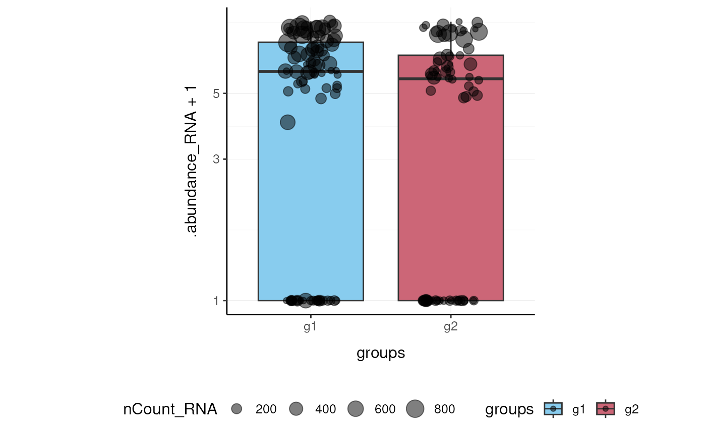
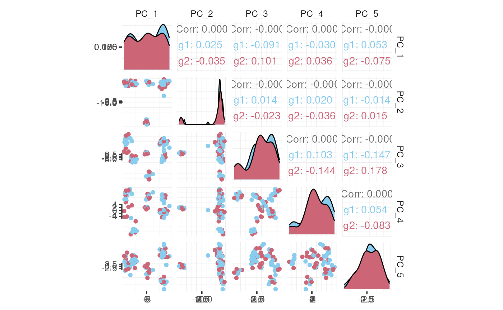

# Overview of the tidyseurat package

[](https://lifecycle.r-lib.org/articles/stages.html)

**Brings Seurat to the tidyverse!**

website:
[stemangiola.github.io/tidyseurat/](https://stemangiola.github.io/tidyseurat/)

Please also have a look at

- [tidyseurat](https://stemangiola.github.io/tidyseurat/) for tidy
  single-cell RNA sequencing analysis
- [tidySummarizedExperiment](https://tidyomics.github.io/tidySummarizedExperiment/)
  for tidy bulk RNA sequencing analysis
- [tidybulk](https://tidyomics.github.io/tidybulk/) for tidy bulk
  RNA-seq analysis
- [tidygate](https://github.com/stemangiola/tidygate/) for adding custom
  gate information to your tibble
- [tidyHeatmap](https://stemangiola.github.io/tidyHeatmap/) for heatmaps
  produced with tidy principles


visual cue

## Introduction

tidyseurat provides a bridge between the Seurat single-cell package
(Butler et al. 2018; Stuart et al. 2019) and the tidyverse (Wickham et
al. 2019). It creates an invisible layer that enables viewing the Seurat
object as a tidyverse tibble, and provides Seurat-compatible *dplyr*,
*tidyr*, *ggplot* and *plotly* functions.

### Functions/utilities available

| Seurat-compatible Functions | Description |
|-----------------------------|-------------|
| `all`                       |             |

| tidyverse Packages | Description                          |
|--------------------|--------------------------------------|
| `dplyr`            | All `dplyr` APIs like for any tibble |
| `tidyr`            | All `tidyr` APIs like for any tibble |
| `ggplot2`          | `ggplot` like for any tibble         |
| `plotly`           | `plot_ly` like for any tibble        |

| Utilities | Description |
|----|----|
| `tidy` | Add `tidyseurat` invisible layer over a Seurat object |
| `as_tibble` | Convert cell-wise information to a `tbl_df` |
| `join_features` | Add feature-wise information, returns a `tbl_df` |
| `aggregate_cells` | Aggregate cell gene-transcription abundance as pseudobulk tissue |

### Installation

From CRAN

\
[`install.packages`](https://rdrr.io/r/utils/install.packages.html)`(``"tidyseurat"``)`

From Github (development)

\
`devtools``::`[`install_github`](https://devtools.r-lib.org/reference/install-deprecated.html)`(``"stemangiola/tidyseurat"``)`

\
[`library`](https://rdrr.io/r/base/library.html)`(`[`dplyr`](https://dplyr.tidyverse.org)`)`\
[`library`](https://rdrr.io/r/base/library.html)`(`[`tidyr`](https://tidyr.tidyverse.org)`)`\
[`library`](https://rdrr.io/r/base/library.html)`(`[`purrr`](https://purrr.tidyverse.org/)`)`\
[`library`](https://rdrr.io/r/base/library.html)`(`[`magrittr`](https://magrittr.tidyverse.org)`)`\
[`library`](https://rdrr.io/r/base/library.html)`(`[`ggplot2`](https://ggplot2.tidyverse.org)`)`\
[`library`](https://rdrr.io/r/base/library.html)`(`[`Seurat`](https://satijalab.org/seurat)`)`\
[`library`](https://rdrr.io/r/base/library.html)`(`[`tidyseurat`](https://github.com/stemangiola/tidyseurat)`)`

### Create `tidyseurat`, the best of both worlds!

This is a seurat object but it is evaluated as tibble. So it is fully
compatible both with Seurat and tidyverse APIs.

\
`pbmc_small`` ``=`` ``SeuratObject``::`[`pbmc_small`](https://satijalab.github.io/seurat-object/reference/pbmc_small.html)

**It looks like a tibble**

\
`pbmc_small`

    ## # A Seurat-tibble abstraction: 80 × 15
    ## # Features=230 | Cells=80 | Active assay=RNA | Assays=RNA
    ##    .cell orig.ident nCount_RNA nFeature_RNA RNA_snn_res.0.8 letter.idents groups
    ##    <chr> <fct>           <dbl>        <int> <fct>           <fct>         <chr> 
    ##  1 ATGC… SeuratPro…         70           47 0               A             g2    
    ##  2 CATG… SeuratPro…         85           52 0               A             g1    
    ##  3 GAAC… SeuratPro…         87           50 1               B             g2    
    ##  4 TGAC… SeuratPro…        127           56 0               A             g2    
    ##  5 AGTC… SeuratPro…        173           53 0               A             g2    
    ##  6 TCTG… SeuratPro…         70           48 0               A             g1    
    ##  7 TGGT… SeuratPro…         64           36 0               A             g1    
    ##  8 GCAG… SeuratPro…         72           45 0               A             g1    
    ##  9 GATA… SeuratPro…         52           36 0               A             g1    
    ## 10 AATG… SeuratPro…        100           41 0               A             g1    
    ## # ℹ 70 more rows
    ## # ℹ 8 more variables: RNA_snn_res.1 <fct>, PC_1 <dbl>, PC_2 <dbl>, PC_3 <dbl>,
    ## #   PC_4 <dbl>, PC_5 <dbl>, tSNE_1 <dbl>, tSNE_2 <dbl>

**But it is a Seurat object after all**

\
`pbmc_small``@``assays`

    ## $RNA
    ## Assay data with 230 features for 80 cells
    ## Top 10 variable features:
    ##  PPBP, IGLL5, VDAC3, CD1C, AKR1C3, PF4, MYL9, GNLY, TREML1, CA2

## Preliminary plots

Set colours and theme for plots.

\
`# Use colourblind-friendly colours`\
`friendly_cols`` ``<-`` `[`c`](https://rdrr.io/r/base/c.html)`(``"#88CCEE"``, ``"#CC6677"``, ``"#DDCC77"``, ``"#117733"``, ``"#332288"``, ``"#AA4499"``, ``"#44AA99"``, ``"#999933"``, ``"#882255"``, ``"#661100"``, ``"#6699CC"``)`\
\
`# Set theme`\
`my_theme`` ``<-`\
`  `[`list`](https://rdrr.io/r/base/list.html)`(`\
`    `[`scale_fill_manual`](https://ggplot2.tidyverse.org/reference/scale_manual.html)`(``values ``=`` ``friendly_cols``)``,`\
`    `[`scale_color_manual`](https://ggplot2.tidyverse.org/reference/scale_manual.html)`(``values ``=`` ``friendly_cols``)``,`\
`    `[`theme_bw`](https://ggplot2.tidyverse.org/reference/ggtheme.html)`(``)`` ``+`\
`      `[`theme`](https://ggplot2.tidyverse.org/reference/theme.html)`(`\
`        panel.border ``=`` `[`element_blank`](https://ggplot2.tidyverse.org/reference/element.html)`(``)``,`\
`        axis.line ``=`` `[`element_line`](https://ggplot2.tidyverse.org/reference/element.html)`(``)``,`\
`        panel.grid.major ``=`` `[`element_line`](https://ggplot2.tidyverse.org/reference/element.html)`(``size ``=`` ``0.2``)``,`\
`        panel.grid.minor ``=`` `[`element_line`](https://ggplot2.tidyverse.org/reference/element.html)`(``size ``=`` ``0.1``)``,`\
`        text ``=`` `[`element_text`](https://ggplot2.tidyverse.org/reference/element.html)`(``size ``=`` ``12``)``,`\
`        legend.position ``=`` ``"bottom"``,`\
`        aspect.ratio ``=`` ``1``,`\
`        strip.background ``=`` `[`element_blank`](https://ggplot2.tidyverse.org/reference/element.html)`(``)``,`\
`        axis.title.x ``=`` `[`element_text`](https://ggplot2.tidyverse.org/reference/element.html)`(``margin ``=`` `[`margin`](https://ggplot2.tidyverse.org/reference/element.html)`(``t ``=`` ``10``, r ``=`` ``10``, b ``=`` ``10``, l ``=`` ``10``)``)``,`\
`        axis.title.y ``=`` `[`element_text`](https://ggplot2.tidyverse.org/reference/element.html)`(``margin ``=`` `[`margin`](https://ggplot2.tidyverse.org/reference/element.html)`(``t ``=`` ``10``, r ``=`` ``10``, b ``=`` ``10``, l ``=`` ``10``)``)`\
`      ``)`\
`  ``)`

We can treat `pbmc_small` effectively as a normal tibble for plotting.

Here we plot number of features per cell.

\
`pbmc_small`` `[`%>%`](../reference/pipe.md)\
`  `[`ggplot`](../reference/ggplot.md)`(`[`aes`](https://ggplot2.tidyverse.org/reference/aes.html)`(``nFeature_RNA``, fill ``=`` ``groups``)``)`` ``+`\
`  `[`geom_histogram`](https://ggplot2.tidyverse.org/reference/geom_histogram.html)`(``)`` ``+`\
`  ``my_theme`



Here we plot total features per cell.

\
`pbmc_small`` `[`%>%`](../reference/pipe.md)\
`  `[`ggplot`](../reference/ggplot.md)`(`[`aes`](https://ggplot2.tidyverse.org/reference/aes.html)`(``groups``, ``nCount_RNA``, fill ``=`` ``groups``)``)`` ``+`\
`  `[`geom_boxplot`](https://ggplot2.tidyverse.org/reference/geom_boxplot.html)`(``outlier.shape ``=`` ``NA``)`` ``+`\
`  `[`geom_jitter`](https://ggplot2.tidyverse.org/reference/geom_jitter.html)`(``width ``=`` ``0.1``)`` ``+`\
`  ``my_theme`



Here we plot abundance of two features for each group.

\
`pbmc_small`` `[`%>%`](../reference/pipe.md)\
`  `[`join_features`](../reference/join_features.md)`(``features ``=`` `[`c`](https://rdrr.io/r/base/c.html)`(``"HLA-DRA"``, ``"LYZ"``)``, shape ``=`` ``"long"``)`` `[`%>%`](../reference/pipe.md)\
`  `[`ggplot`](../reference/ggplot.md)`(`[`aes`](https://ggplot2.tidyverse.org/reference/aes.html)`(``groups``, ``.abundance_RNA`` ``+`` ``1``, fill ``=`` ``groups``)``)`` ``+`\
`  `[`geom_boxplot`](https://ggplot2.tidyverse.org/reference/geom_boxplot.html)`(``outlier.shape ``=`` ``NA``)`` ``+`\
`  `[`geom_jitter`](https://ggplot2.tidyverse.org/reference/geom_jitter.html)`(`[`aes`](https://ggplot2.tidyverse.org/reference/aes.html)`(``size ``=`` ``nCount_RNA``)``, alpha ``=`` ``0.5``, width ``=`` ``0.2``)`` ``+`\
`  `[`scale_y_log10`](https://ggplot2.tidyverse.org/reference/scale_continuous.html)`(``)`` ``+`\
`  ``my_theme`



## Preprocess the dataset

Also you can treat the object as Seurat object and proceed with data
processing.

\
`pbmc_small_pca`` ``<-`\
`  ``pbmc_small`` `[`%>%`](../reference/pipe.md)\
`  `[`SCTransform`](https://satijalab.org/seurat/reference/SCTransform.html)`(``verbose ``=`` ``FALSE``)`` `[`%>%`](../reference/pipe.md)\
`  `[`FindVariableFeatures`](https://satijalab.org/seurat/reference/FindVariableFeatures.html)`(``verbose ``=`` ``FALSE``)`` `[`%>%`](../reference/pipe.md)\
`  `[`RunPCA`](https://satijalab.org/seurat/reference/RunPCA.html)`(``verbose ``=`` ``FALSE``)`\
\
`pbmc_small_pca`

    ## # A Seurat-tibble abstraction: 80 × 17
    ## # Features=220 | Cells=80 | Active assay=SCT | Assays=RNA, SCT
    ##    .cell orig.ident nCount_RNA nFeature_RNA RNA_snn_res.0.8 letter.idents groups
    ##    <chr> <fct>           <dbl>        <int> <fct>           <fct>         <chr> 
    ##  1 ATGC… SeuratPro…         70           47 0               A             g2    
    ##  2 CATG… SeuratPro…         85           52 0               A             g1    
    ##  3 GAAC… SeuratPro…         87           50 1               B             g2    
    ##  4 TGAC… SeuratPro…        127           56 0               A             g2    
    ##  5 AGTC… SeuratPro…        173           53 0               A             g2    
    ##  6 TCTG… SeuratPro…         70           48 0               A             g1    
    ##  7 TGGT… SeuratPro…         64           36 0               A             g1    
    ##  8 GCAG… SeuratPro…         72           45 0               A             g1    
    ##  9 GATA… SeuratPro…         52           36 0               A             g1    
    ## 10 AATG… SeuratPro…        100           41 0               A             g1    
    ## # ℹ 70 more rows
    ## # ℹ 10 more variables: RNA_snn_res.1 <fct>, nCount_SCT <dbl>,
    ## #   nFeature_SCT <int>, PC_1 <dbl>, PC_2 <dbl>, PC_3 <dbl>, PC_4 <dbl>,
    ## #   PC_5 <dbl>, tSNE_1 <dbl>, tSNE_2 <dbl>

If a tool is not included in the tidyseurat collection, we can use
`as_tibble` to permanently convert `tidyseurat` into tibble.

\
`pbmc_small_pca`` `[`%>%`](../reference/pipe.md)\
`  `[`as_tibble`](../reference/as_tibble.md)`(``)`` `[`%>%`](../reference/pipe.md)\
`  `[`select`](../reference/select.md)`(`[`contains`](https://tidyselect.r-lib.org/reference/starts_with.html)`(``"PC"``)``, `[`everything`](https://tidyselect.r-lib.org/reference/everything.html)`(``)``)`` `[`%>%`](../reference/pipe.md)\
`  ``GGally``::`[`ggpairs`](https://ggobi.github.io/ggally/reference/ggpairs.html)`(``columns ``=`` ``1``:``5``, ``ggplot2``::`[`aes`](https://ggplot2.tidyverse.org/reference/aes.html)`(``colour ``=`` ``groups``)``)`` ``+`\
`  ``my_theme`



## Identify clusters

We proceed with cluster identification with Seurat.

\
`pbmc_small_cluster`` ``<-`\
`  ``pbmc_small_pca`` `[`%>%`](../reference/pipe.md)\
`  `[`FindNeighbors`](https://satijalab.org/seurat/reference/FindNeighbors.html)`(``verbose ``=`` ``FALSE``)`` `[`%>%`](../reference/pipe.md)\
`  `[`FindClusters`](https://satijalab.org/seurat/reference/FindClusters.html)`(``method ``=`` ``"igraph"``, verbose ``=`` ``FALSE``)`\
\
`pbmc_small_cluster`

    ## # A Seurat-tibble abstraction: 80 × 19
    ## # Features=220 | Cells=80 | Active assay=SCT | Assays=RNA, SCT
    ##    .cell orig.ident nCount_RNA nFeature_RNA RNA_snn_res.0.8 letter.idents groups
    ##    <chr> <fct>           <dbl>        <int> <fct>           <fct>         <chr> 
    ##  1 ATGC… SeuratPro…         70           47 0               A             g2    
    ##  2 CATG… SeuratPro…         85           52 0               A             g1    
    ##  3 GAAC… SeuratPro…         87           50 1               B             g2    
    ##  4 TGAC… SeuratPro…        127           56 0               A             g2    
    ##  5 AGTC… SeuratPro…        173           53 0               A             g2    
    ##  6 TCTG… SeuratPro…         70           48 0               A             g1    
    ##  7 TGGT… SeuratPro…         64           36 0               A             g1    
    ##  8 GCAG… SeuratPro…         72           45 0               A             g1    
    ##  9 GATA… SeuratPro…         52           36 0               A             g1    
    ## 10 AATG… SeuratPro…        100           41 0               A             g1    
    ## # ℹ 70 more rows
    ## # ℹ 12 more variables: RNA_snn_res.1 <fct>, nCount_SCT <dbl>,
    ## #   nFeature_SCT <int>, SCT_snn_res.0.8 <fct>, seurat_clusters <fct>,
    ## #   PC_1 <dbl>, PC_2 <dbl>, PC_3 <dbl>, PC_4 <dbl>, PC_5 <dbl>, tSNE_1 <dbl>,
    ## #   tSNE_2 <dbl>

Now we can interrogate the object as if it was a regular tibble data
frame.

\
`pbmc_small_cluster`` `[`%>%`](../reference/pipe.md)\
`  `[`count`](../reference/count.md)`(``groups``, ``seurat_clusters``)`

    ## # A tibble: 6 × 3
    ##   groups seurat_clusters     n
    ##   <chr>  <fct>           <int>
    ## 1 g1     0                  23
    ## 2 g1     1                  17
    ## 3 g1     2                   4
    ## 4 g2     0                  17
    ## 5 g2     1                  13
    ## 6 g2     2                   6

We can identify cluster markers using Seurat.

\
`# Identify top 10 markers per cluster`\
`markers`` ``<-`\
`  ``pbmc_small_cluster`` `[`%>%`](../reference/pipe.md)\
`  `[`FindAllMarkers`](https://satijalab.org/seurat/reference/FindAllMarkers.html)`(``only.pos ``=`` ``TRUE``, min.pct ``=`` ``0.25``, thresh.use ``=`` ``0.25``)`` `[`%>%`](../reference/pipe.md)\
`  `[`group_by`](../reference/group_by.md)`(``cluster``)`` `[`%>%`](../reference/pipe.md)\
`  `[`top_n`](https://dplyr.tidyverse.org/reference/top_n.html)`(``10``, ``avg_log2FC``)`\
\
`# Plot heatmap`\
`pbmc_small_cluster`` `[`%>%`](../reference/pipe.md)\
`  `[`DoHeatmap`](https://satijalab.org/seurat/reference/DoHeatmap.html)`(`\
`    features ``=`` ``markers``$``gene``,`\
`    group.colors ``=`` ``friendly_cols`\
`  ``)`

## Reduce dimensions

We can calculate the first 3 UMAP dimensions using the Seurat framework.

\
`pbmc_small_UMAP`` ``<-`\
`  ``pbmc_small_cluster`` `[`%>%`](../reference/pipe.md)\
`  `[`RunUMAP`](https://satijalab.org/seurat/reference/RunUMAP.html)`(``reduction ``=`` ``"pca"``, dims ``=`` ``1``:``15``, n.components ``=`` ``3L``)`

And we can plot them using 3D plot using plotly.

\
`pbmc_small_UMAP`` `[`%>%`](../reference/pipe.md)\
`  `[`plot_ly`](../reference/plotly.md)`(`\
`    x ``=`` ``~``` `UMAP_1` ```,`\
`    y ``=`` ``~``` `UMAP_2` ```,`\
`    z ``=`` ``~``` `UMAP_3` ```,`\
`    color ``=`` ``~``seurat_clusters``,`\
`    colors ``=`` ``friendly_cols``[``1``:``4``]`\
`  ``)`


screenshot plotly

### Cell type prediction

We can infer cell type identities using *SingleR* (Aran et al. 2019) and
manipulate the output using tidyverse.

\
`# Get cell type reference data`\
`blueprint`` ``<-`` ``celldex``::``BlueprintEncodeData``(``)`\
\
`# Infer cell identities`\
`cell_type_df`` ``<-`\
`  `[`GetAssayData`](https://satijalab.github.io/seurat-object/reference/AssayData.html)`(``pbmc_small_UMAP``, slot ``=`` ``'counts'``, assay ``=`` ``"SCT"``)`` `[`%>%`](../reference/pipe.md)\
`  `[`log1p`](https://rdrr.io/r/base/Log.html)`(``)`` `[`%>%`](../reference/pipe.md)\
`  ``Matrix``::`[`Matrix`](https://rdrr.io/pkg/Matrix/man/Matrix.html)`(``sparse ``=`` ``TRUE``)`` `[`%>%`](../reference/pipe.md)\
`  ``SingleR``::``SingleR``(`\
`    ref ``=`` ``blueprint``,`\
`    labels ``=`` ``blueprint``$``label.main``,`\
`    method ``=`` ``"single"`\
`  ``)`` `[`%>%`](../reference/pipe.md)\
`  `[`as.data.frame`](https://rdrr.io/r/base/as.data.frame.html)`(``)`` `[`%>%`](../reference/pipe.md)\
`  `[`as_tibble`](../reference/as_tibble.md)`(``rownames ``=`` ``"cell"``)`` `[`%>%`](../reference/pipe.md)\
`  `[`select`](../reference/select.md)`(``cell``, ``first.labels``)`

\
`# Join UMAP and cell type info`\
`pbmc_small_cell_type`` ``<-`\
`  ``pbmc_small_UMAP`` `[`%>%`](../reference/pipe.md)\
`  `[`left_join`](../reference/left_join.md)`(``cell_type_df``, by ``=`` ``"cell"``)`\
\
`# Reorder columns`\
`pbmc_small_cell_type`` `[`%>%`](../reference/pipe.md)\
`  `[`select`](../reference/select.md)`(``cell``, ``first.labels``, `[`everything`](https://tidyselect.r-lib.org/reference/everything.html)`(``)``)`

We can easily summarise the results. For example, we can see how cell
type classification overlaps with cluster classification.

\
`pbmc_small_cell_type`` `[`%>%`](../reference/pipe.md)\
`  `[`count`](../reference/count.md)`(``seurat_clusters``, ``first.labels``)`

We can easily reshape the data for building information-rich faceted
plots.

\
`pbmc_small_cell_type`` `[`%>%`](../reference/pipe.md)\
\
`  ``# Reshape and add classifier column`\
`  `[`pivot_longer`](../reference/pivot_longer.md)`(`\
`    cols ``=`` `[`c`](https://rdrr.io/r/base/c.html)`(``seurat_clusters``, ``first.labels``)``,`\
`    names_to ``=`` ``"classifier"``, values_to ``=`` ``"label"`\
`  ``)`` `[`%>%`](../reference/pipe.md)\
\
`  ``# UMAP plots for cell type and cluster`\
`  `[`ggplot`](../reference/ggplot.md)`(`[`aes`](https://ggplot2.tidyverse.org/reference/aes.html)`(``UMAP_1``, ``UMAP_2``, color ``=`` ``label``)``)`` ``+`\
`  `[`geom_point`](https://ggplot2.tidyverse.org/reference/geom_point.html)`(``)`` ``+`\
`  `[`facet_wrap`](https://ggplot2.tidyverse.org/reference/facet_wrap.html)`(``~``classifier``)`` ``+`\
`  ``my_theme`

We can easily plot gene correlation per cell category, adding
multi-layer annotations.

\
`pbmc_small_cell_type`` `[`%>%`](../reference/pipe.md)\
\
`  ``# Add some mitochondrial abundance values`\
`  `[`mutate`](../reference/mutate.md)`(``mitochondrial ``=`` `[`rnorm`](https://rdrr.io/r/stats/Normal.html)`(`[`n`](https://dplyr.tidyverse.org/reference/context.html)`(``)``)``)`` `[`%>%`](../reference/pipe.md)\
\
`  ``# Plot correlation`\
`  `[`join_features`](../reference/join_features.md)`(``features ``=`` `[`c`](https://rdrr.io/r/base/c.html)`(``"CST3"``, ``"LYZ"``)``, shape ``=`` ``"wide"``)`` `[`%>%`](../reference/pipe.md)\
`  `[`ggplot`](../reference/ggplot.md)`(`[`aes`](https://ggplot2.tidyverse.org/reference/aes.html)`(``CST3`` ``+`` ``1``, ``LYZ`` ``+`` ``1``, color ``=`` ``groups``, size ``=`` ``mitochondrial``)``)`` ``+`\
`  `[`geom_point`](https://ggplot2.tidyverse.org/reference/geom_point.html)`(``)`` ``+`\
`  `[`facet_wrap`](https://ggplot2.tidyverse.org/reference/facet_wrap.html)`(``~``first.labels``, scales ``=`` ``"free"``)`` ``+`\
`  `[`scale_x_log10`](https://ggplot2.tidyverse.org/reference/scale_continuous.html)`(``)`` ``+`\
`  `[`scale_y_log10`](https://ggplot2.tidyverse.org/reference/scale_continuous.html)`(``)`` ``+`\
`  ``my_theme`

## Nested analyses

A powerful tool we can use with tidyseurat is `nest`. We can easily
perform independent analyses on subsets of the dataset. First we
classify cell types in lymphoid and myeloid; then, nest based on the new
classification

\
`pbmc_small_nested`` ``<-`\
`  ``pbmc_small_cell_type`` `[`%>%`](../reference/pipe.md)\
`  `[`filter`](../reference/filter.md)`(``first.labels`` ``!=`` ``"Erythrocytes"``)`` `[`%>%`](../reference/pipe.md)\
`  `[`mutate`](../reference/mutate.md)`(``cell_class ``=`` `[`if_else`](https://dplyr.tidyverse.org/reference/if_else.html)`(``` `first.labels` ``` `[`%in%`](https://rdrr.io/r/base/match.html)` `[`c`](https://rdrr.io/r/base/c.html)`(``"Macrophages"``, ``"Monocytes"``)``, ``"myeloid"``, ``"lymphoid"``)``)`` `[`%>%`](../reference/pipe.md)\
`  `[`nest`](../reference/nest.md)`(``data ``=`` ``-``cell_class``)`\
\
`pbmc_small_nested`

Now we can independently for the lymphoid and myeloid subsets (i) find
variable features, (ii) reduce dimensions, and (iii) cluster using both
tidyverse and Seurat seamlessly.

\
`pbmc_small_nested_reanalysed`` ``<-`\
`  ``pbmc_small_nested`` `[`%>%`](../reference/pipe.md)\
`  `[`mutate`](../reference/mutate.md)`(``data ``=`` `[`map`](https://purrr.tidyverse.org/reference/map.html)`(`\
`    ``data``, ``~`` ``.x`` `[`%>%`](../reference/pipe.md)\
`      `[`FindVariableFeatures`](https://satijalab.org/seurat/reference/FindVariableFeatures.html)`(``verbose ``=`` ``FALSE``)`` `[`%>%`](../reference/pipe.md)\
`      `[`RunPCA`](https://satijalab.org/seurat/reference/RunPCA.html)`(``npcs ``=`` ``10``, verbose ``=`` ``FALSE``)`` `[`%>%`](../reference/pipe.md)\
`      `[`FindNeighbors`](https://satijalab.org/seurat/reference/FindNeighbors.html)`(``verbose ``=`` ``FALSE``)`` `[`%>%`](../reference/pipe.md)\
`      `[`FindClusters`](https://satijalab.org/seurat/reference/FindClusters.html)`(``method ``=`` ``"igraph"``, verbose ``=`` ``FALSE``)`` `[`%>%`](../reference/pipe.md)\
`      `[`RunUMAP`](https://satijalab.org/seurat/reference/RunUMAP.html)`(``reduction ``=`` ``"pca"``, dims ``=`` ``1``:``10``, n.components ``=`` ``3L``, verbose ``=`` ``FALSE``)`\
`  ``)``)`\
\
`pbmc_small_nested_reanalysed`

Now we can unnest and plot the new classification.

\
`pbmc_small_nested_reanalysed`` `[`%>%`](../reference/pipe.md)\
\
`  ``# Convert to tibble otherwise Seurat drops reduced dimensions when unifying data sets.`\
`  `[`mutate`](../reference/mutate.md)`(``data ``=`` `[`map`](https://purrr.tidyverse.org/reference/map.html)`(``data``, ``~`` ``.x`` `[`%>%`](../reference/pipe.md)` `[`as_tibble`](../reference/as_tibble.md)`(``)``)``)`` `[`%>%`](../reference/pipe.md)\
`  `[`unnest`](../reference/unnest.md)`(``data``)`` `[`%>%`](../reference/pipe.md)\
\
`  ``# Define unique clusters`\
`  `[`unite`](../reference/unite.md)`(``"cluster"``, `[`c`](https://rdrr.io/r/base/c.html)`(``cell_class``, ``seurat_clusters``)``, remove ``=`` ``FALSE``)`` `[`%>%`](../reference/pipe.md)\
\
`  ``# Plotting`\
`  `[`ggplot`](../reference/ggplot.md)`(`[`aes`](https://ggplot2.tidyverse.org/reference/aes.html)`(``UMAP_1``, ``UMAP_2``, color ``=`` ``cluster``)``)`` ``+`\
`  `[`geom_point`](https://ggplot2.tidyverse.org/reference/geom_point.html)`(``)`` ``+`\
`  `[`facet_wrap`](https://ggplot2.tidyverse.org/reference/facet_wrap.html)`(``~``cell_class``)`` ``+`\
`  ``my_theme`

## Aggregating cells

Sometimes, it is necessary to aggregate the gene-transcript abundance
from a group of cells into a single value. For example, when comparing
groups of cells across different samples with fixed-effect models.

In tidyseurat, cell aggregation can be achieved using the
`aggregate_cells` function.

\
`pbmc_small`` `[`%>%`](../reference/pipe.md)\
`  `[`aggregate_cells`](../reference/aggregate_cells.md)`(``groups``, assays ``=`` ``"RNA"``)`

## Session Info

\
[`sessionInfo`](https://rdrr.io/r/utils/sessionInfo.html)`(``)`

    ## R version 4.6.1 (2026-06-24)
    ## Platform: x86_64-pc-linux-gnu
    ## Running under: Ubuntu 24.04.5 LTS
    ## 
    ## Matrix products: default
    ## BLAS:   /usr/lib/x86_64-linux-gnu/openblas-pthread/libblas.so.3 
    ## LAPACK: /usr/lib/x86_64-linux-gnu/openblas-pthread/libopenblasp-r0.3.26.so;  LAPACK version 3.12.0
    ## 
    ## locale:
    ##  [1] LC_CTYPE=en_US.UTF-8       LC_NUMERIC=C              
    ##  [3] LC_TIME=en_US.UTF-8        LC_COLLATE=en_US.UTF-8    
    ##  [5] LC_MONETARY=en_US.UTF-8    LC_MESSAGES=en_US.UTF-8   
    ##  [7] LC_PAPER=en_US.UTF-8       LC_NAME=C                 
    ##  [9] LC_ADDRESS=C               LC_TELEPHONE=C            
    ## [11] LC_MEASUREMENT=en_US.UTF-8 LC_IDENTIFICATION=C       
    ## 
    ## time zone: UTC
    ## tzcode source: system (glibc)
    ## 
    ## attached base packages:
    ## [1] stats     graphics  grDevices utils     datasets  methods   base     
    ## 
    ## other attached packages:
    ##  [1] future_1.80.0      tidyseurat_0.8.10  ttservice_0.5.3    Seurat_5.6.0      
    ##  [5] SeuratObject_5.4.0 sp_2.2-4           ggplot2_4.0.3      magrittr_2.0.5    
    ##  [9] purrr_1.2.2        tidyr_1.3.2        dplyr_1.2.1        knitr_1.52        
    ## 
    ## loaded via a namespace (and not attached):
    ##   [1] deldir_2.0-4           pbapply_1.7-5          gridExtra_2.3.1       
    ##   [4] rlang_1.3.0            RcppAnnoy_0.0.23       otel_0.2.0            
    ##   [7] spatstat.geom_3.8-3    matrixStats_1.5.0      ggridges_0.5.7        
    ##  [10] compiler_4.6.1         png_0.1-9              systemfonts_1.3.2     
    ##  [13] vctrs_0.7.3            reshape2_1.4.5         stringr_1.6.0         
    ##  [16] pkgconfig_2.0.3        fastmap_1.2.0          labeling_0.4.3        
    ##  [19] utf8_1.2.6             promises_1.5.0         rmarkdown_2.32        
    ##  [22] ragg_1.5.2             xfun_0.62              cachem_1.1.0          
    ##  [25] jsonlite_2.0.0         goftest_1.2-3          later_1.4.8           
    ##  [28] spatstat.utils_3.2-5   irlba_2.4.1            parallel_4.6.1        
    ##  [31] cluster_2.1.8.3        R6_2.6.1               ica_1.0-3             
    ##  [34] spatstat.data_3.1-9    bslib_0.12.0           stringi_1.8.9         
    ##  [37] RColorBrewer_1.1-3     GGally_2.4.0           reticulate_1.47.0     
    ##  [40] spatstat.univar_3.2-0  parallelly_1.48.0      lmtest_0.9-40         
    ##  [43] jquerylib_0.1.4        scattermore_1.2        Rcpp_1.1.2            
    ##  [46] tensor_1.5.1           future.apply_1.21.0    zoo_1.9-1             
    ##  [49] sctransform_0.4.3      httpuv_1.6.17          Matrix_1.7-6          
    ##  [52] splines_4.6.1          igraph_2.3.4           tidyselect_1.2.1      
    ##  [55] abind_1.4-8            yaml_2.3.12            spatstat.random_3.5-2 
    ##  [58] codetools_0.2-20       miniUI_0.1.2           spatstat.explore_3.8-3
    ##  [61] listenv_1.1.0          lattice_0.23-1         tibble_3.3.1          
    ##  [64] plyr_1.8.9             shiny_1.14.0           withr_3.0.3           
    ##  [67] S7_0.2.2               ROCR_1.0-12            evaluate_1.0.5        
    ##  [70] Rtsne_0.17             fastDummies_1.7.6      desc_1.4.3            
    ##  [73] survival_3.8-12        ggstats_0.14.0         polyclip_1.10-7       
    ##  [76] fitdistrplus_1.2-6     pillar_1.11.1          KernSmooth_2.23-27    
    ##  [79] plotly_4.12.1          generics_0.1.4         RcppHNSW_0.7.0        
    ##  [82] scales_1.4.0           globals_0.20.0         xtable_1.8-8          
    ##  [85] glue_1.8.1             tools_4.6.1            data.table_1.18.6.1   
    ##  [88] RSpectra_0.16-2        RANN_2.6.3             fs_2.1.0              
    ##  [91] dotCall64_1.2          cowplot_1.2.0          grid_4.6.1            
    ##  [94] nlme_3.1-171           patchwork_1.3.2        cli_3.6.6             
    ##  [97] spatstat.sparse_3.2-0  textshaping_1.0.5      fansi_1.0.7           
    ## [100] spam_2.11-4            viridisLite_0.4.3      uwot_0.2.5            
    ## [103] gtable_0.3.6           sass_0.4.10            digest_0.6.39         
    ## [106] progressr_1.1.0        ggrepel_0.9.8          htmlwidgets_1.6.4     
    ## [109] farver_2.1.2           htmltools_0.5.9        pkgdown_2.2.1         
    ## [112] lifecycle_1.0.5        httr_1.4.9             mime_0.13             
    ## [115] MASS_7.3-66

## References

Aran, Dvir, Agnieszka P Looney, Leqian Liu, et al. 2019.
“Reference-Based Analysis of Lung Single-Cell Sequencing Reveals a
Transitional Profibrotic Macrophage.” *Nature Immunology* 20 (2):
163–72.

Butler, Andrew, Paul Hoffman, Peter Smibert, Efthymia Papalexi, and
Rahul Satija. 2018. “Integrating Single-Cell Transcriptomic Data Across
Different Conditions, Technologies, and Species.” *Nature Biotechnology*
36 (5): 411–20.

Stuart, Tim, Andrew Butler, Paul Hoffman, et al. 2019. “Comprehensive
Integration of Single-Cell Data.” *Cell* 177 (7): 1888–902.

Wickham, Hadley, Mara Averick, Jennifer Bryan, et al. 2019. “Welcome to
the Tidyverse.” *Journal of Open Source Software* 4 (43): 1686.
