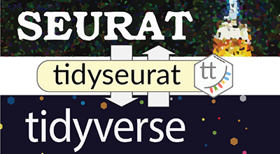
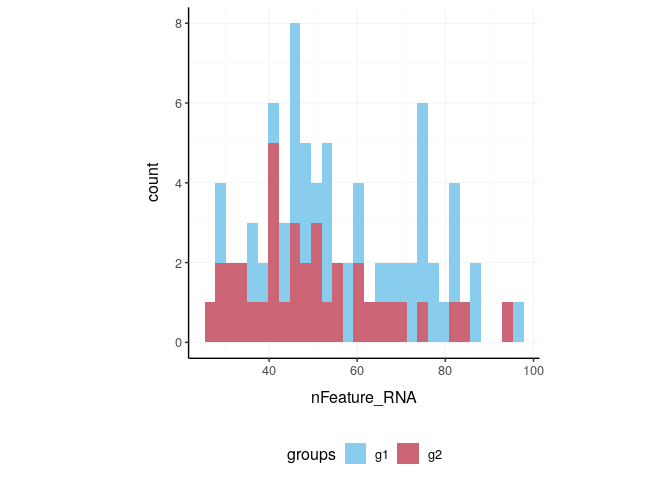
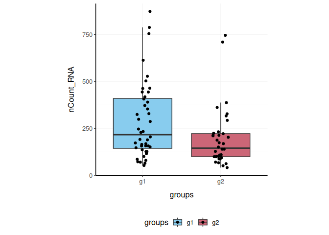
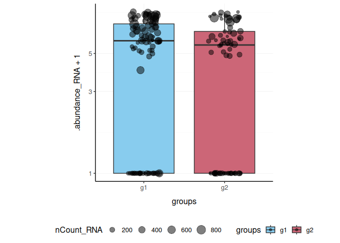
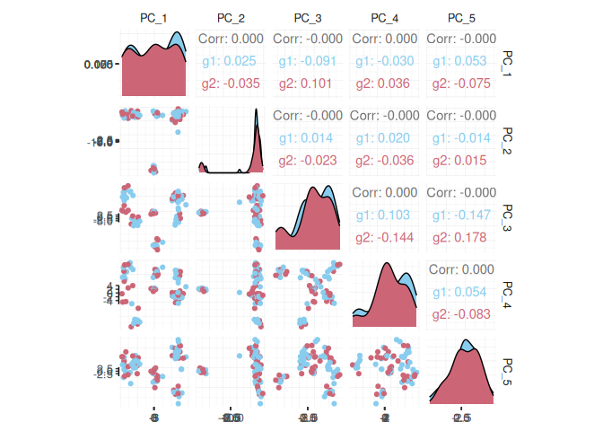
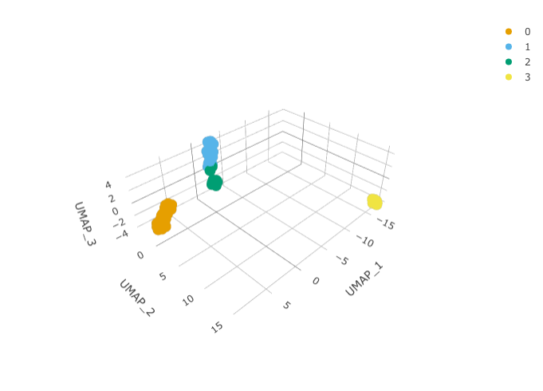

# tidyseurat - part of tidytranscriptomics

[](https://www.youtube.com/watch?feature=player_embedded&v=wKnyocRCvW4)

**Brings Seurat to the tidyverse!**

website:
[stemangiola.github.io/tidyseurat/](https://stemangiola.github.io/tidyseurat/)

Please also have a look at

- [tidyseurat](https://stemangiola.github.io/tidyseurat/) for tidy
  single-cell RNA sequencing analysis
- [tidySummarizedExperiment](https://tidyomics.github.io/tidySummarizedExperiment/)
  for tidy bulk RNA sequencing analysis
- [tidybulk](https://tidyomics.github.io/tidybulk/) for tidy bulk
  RNA-seq analysis
- [tidygate](https://github.com/stemangiola/tidygate/) for adding custom
  gate information to your tibble
- [tidyHeatmap](https://stemangiola.github.io/tidyHeatmap/) for heatmaps
  produced with tidy principles



visual cue

# Introduction

tidyseurat provides a bridge between the Seurat single-cell package
\[@butler2018integrating; @stuart2019comprehensive\] and the tidyverse
\[@wickham2019welcome\]. It creates an invisible layer that enables
viewing the Seurat object as a tidyverse tibble, and provides
Seurat-compatible *dplyr*, *tidyr*, *ggplot* and *plotly* functions.

## Functions/utilities available

| Seurat-compatible Functions | Description |
|-----------------------------|-------------|
| `all`                       |             |

| tidyverse Packages | Description                          |
|--------------------|--------------------------------------|
| `dplyr`            | All `dplyr` APIs like for any tibble |
| `tidyr`            | All `tidyr` APIs like for any tibble |
| `ggplot2`          | `ggplot` like for any tibble         |
| `plotly`           | `plot_ly` like for any tibble        |

| Utilities | Description |
|----|----|
| `tidy` | Add `tidyseurat` invisible layer over a Seurat object |
| `as_tibble` | Convert cell-wise information to a `tbl_df` |
| `join_features` | Add feature-wise information, returns a `tbl_df` |
| `aggregate_cells` | Aggregate cell gene-transcription abundance as pseudobulk tissue |

## Installation

From CRAN

\
[`install.packages`](https://rdrr.io/r/utils/install.packages.html)`(``"tidyseurat"``)`

From Github (development)

\
`devtools``::`[`install_github`](https://devtools.r-lib.org/reference/install-deprecated.html)`(``"stemangiola/tidyseurat"``)`

\
[`library`](https://rdrr.io/r/base/library.html)`(`[`dplyr`](https://dplyr.tidyverse.org)`)`\
[`library`](https://rdrr.io/r/base/library.html)`(`[`tidyr`](https://tidyr.tidyverse.org)`)`\
[`library`](https://rdrr.io/r/base/library.html)`(`[`purrr`](https://purrr.tidyverse.org/)`)`\
[`library`](https://rdrr.io/r/base/library.html)`(`[`magrittr`](https://magrittr.tidyverse.org)`)`\
[`library`](https://rdrr.io/r/base/library.html)`(`[`ggplot2`](https://ggplot2.tidyverse.org)`)`\
[`library`](https://rdrr.io/r/base/library.html)`(`[`Seurat`](https://satijalab.org/seurat)`)`\
[`library`](https://rdrr.io/r/base/library.html)`(`[`tidyseurat`](https://github.com/stemangiola/tidyseurat)`)`

## Create `tidyseurat`, the best of both worlds!

This is a seurat object but it is evaluated as tibble. So it is fully
compatible both with Seurat and tidyverse APIs.

\
`pbmc_small`` ``=`` ``SeuratObject``::`[`pbmc_small`](https://satijalab.github.io/seurat-object/reference/pbmc_small.html)

**It looks like a tibble**

\
`pbmc_small`

``` R
## 
[90m# A Seurat-tibble abstraction: 80 × 15
[39m
## 
[90m# 
[90mFeatures=230 | Cells=80 | Active assay=RNA | Assays=RNA
[0m
[39m
##    .cell orig.ident nCount_RNA nFeature_RNA RNA_snn_res.0.8 letter.idents groups
##    
[3m
[90m<chr>
[39m
[23m 
[3m
[90m<fct>
[39m
[23m           
[3m
[90m<dbl>
[39m
[23m        
[3m
[90m<int>
[39m
[23m 
[3m
[90m<fct>
[39m
[23m           
[3m
[90m<fct>
[39m
[23m         
[3m
[90m<chr>
[39m
[23m 
## 
[90m 1
[39m ATGC… SeuratPro…         70           47 0               A             g2    
## 
[90m 2
[39m CATG… SeuratPro…         85           52 0               A             g1    
## 
[90m 3
[39m GAAC… SeuratPro…         87           50 1               B             g2    
## 
[90m 4
[39m TGAC… SeuratPro…        127           56 0               A             g2    
## 
[90m 5
[39m AGTC… SeuratPro…        173           53 0               A             g2    
## 
[90m 6
[39m TCTG… SeuratPro…         70           48 0               A             g1    
## 
[90m 7
[39m TGGT… SeuratPro…         64           36 0               A             g1    
## 
[90m 8
[39m GCAG… SeuratPro…         72           45 0               A             g1    
## 
[90m 9
[39m GATA… SeuratPro…         52           36 0               A             g1    
## 
[90m10
[39m AATG… SeuratPro…        100           41 0               A             g1    
## 
[90m# ℹ 70 more rows
[39m
## 
[90m# ℹ 8 more variables: RNA_snn_res.1 <fct>, PC_1 <dbl>, PC_2 <dbl>, PC_3 <dbl>,
[39m
## 
[90m#   PC_4 <dbl>, PC_5 <dbl>, tSNE_1 <dbl>, tSNE_2 <dbl>
[39m
```

**But it is a Seurat object after all**

\
`pbmc_small``@``assays`

``` R
## $RNA
## Assay data with 230 features for 80 cells
## Top 10 variable features:
##  PPBP, IGLL5, VDAC3, CD1C, AKR1C3, PF4, MYL9, GNLY, TREML1, CA2
```

# Preliminary plots

Set colours and theme for plots.

\
`# Use colourblind-friendly colours`\
`friendly_cols`` ``<-`` `[`c`](https://rdrr.io/r/base/c.html)`(``"#88CCEE"``, ``"#CC6677"``, ``"#DDCC77"``, ``"#117733"``, ``"#332288"``, ``"#AA4499"``, ``"#44AA99"``, ``"#999933"``, ``"#882255"``, ``"#661100"``, ``"#6699CC"``)`\
\
`# Set theme`\
`my_theme`` ``<-`\
`  `[`list`](https://rdrr.io/r/base/list.html)`(`\
`    `[`scale_fill_manual`](https://ggplot2.tidyverse.org/reference/scale_manual.html)`(``values ``=`` ``friendly_cols``)``,`\
`    `[`scale_color_manual`](https://ggplot2.tidyverse.org/reference/scale_manual.html)`(``values ``=`` ``friendly_cols``)``,`\
`    `[`theme_bw`](https://ggplot2.tidyverse.org/reference/ggtheme.html)`(``)`` ``+`\
`      `[`theme`](https://ggplot2.tidyverse.org/reference/theme.html)`(`\
`        panel.border ``=`` `[`element_blank`](https://ggplot2.tidyverse.org/reference/element.html)`(``)``,`\
`        axis.line ``=`` `[`element_line`](https://ggplot2.tidyverse.org/reference/element.html)`(``)``,`\
`        panel.grid.major ``=`` `[`element_line`](https://ggplot2.tidyverse.org/reference/element.html)`(``size ``=`` ``0.2``)``,`\
`        panel.grid.minor ``=`` `[`element_line`](https://ggplot2.tidyverse.org/reference/element.html)`(``size ``=`` ``0.1``)``,`\
`        text ``=`` `[`element_text`](https://ggplot2.tidyverse.org/reference/element.html)`(``size ``=`` ``12``)``,`\
`        legend.position ``=`` ``"bottom"``,`\
`        aspect.ratio ``=`` ``1``,`\
`        strip.background ``=`` `[`element_blank`](https://ggplot2.tidyverse.org/reference/element.html)`(``)``,`\
`        axis.title.x ``=`` `[`element_text`](https://ggplot2.tidyverse.org/reference/element.html)`(``margin ``=`` `[`margin`](https://ggplot2.tidyverse.org/reference/element.html)`(``t ``=`` ``10``, r ``=`` ``10``, b ``=`` ``10``, l ``=`` ``10``)``)``,`\
`        axis.title.y ``=`` `[`element_text`](https://ggplot2.tidyverse.org/reference/element.html)`(``margin ``=`` `[`margin`](https://ggplot2.tidyverse.org/reference/element.html)`(``t ``=`` ``10``, r ``=`` ``10``, b ``=`` ``10``, l ``=`` ``10``)``)`\
`      ``)`\
`  ``)`

We can treat `pbmc_small` effectively as a normal tibble for plotting.

Here we plot number of features per cell.

\
`pbmc_small`` `[`%>%`](reference/pipe.md)\
`  `[`ggplot`](reference/ggplot.md)`(`[`aes`](https://ggplot2.tidyverse.org/reference/aes.html)`(``nFeature_RNA``, fill ``=`` ``groups``)``)`` ``+`\
`  `[`geom_histogram`](https://ggplot2.tidyverse.org/reference/geom_histogram.html)`(``)`` ``+`\
`  ``my_theme`



Here we plot total features per cell.

\
`pbmc_small`` `[`%>%`](reference/pipe.md)\
`  `[`ggplot`](reference/ggplot.md)`(`[`aes`](https://ggplot2.tidyverse.org/reference/aes.html)`(``groups``, ``nCount_RNA``, fill ``=`` ``groups``)``)`` ``+`\
`  `[`geom_boxplot`](https://ggplot2.tidyverse.org/reference/geom_boxplot.html)`(``outlier.shape ``=`` ``NA``)`` ``+`\
`  `[`geom_jitter`](https://ggplot2.tidyverse.org/reference/geom_jitter.html)`(``width ``=`` ``0.1``)`` ``+`\
`  ``my_theme`



Here we plot abundance of two features for each group.

\
`pbmc_small`` `[`%>%`](reference/pipe.md)\
`  `[`join_features`](reference/join_features.md)`(``features ``=`` `[`c`](https://rdrr.io/r/base/c.html)`(``"HLA-DRA"``, ``"LYZ"``)``, shape ``=`` ``"long"``)`` `[`%>%`](reference/pipe.md)\
`  `[`ggplot`](reference/ggplot.md)`(`[`aes`](https://ggplot2.tidyverse.org/reference/aes.html)`(``groups``, ``.abundance_RNA`` ``+`` ``1``, fill ``=`` ``groups``)``)`` ``+`\
`  `[`geom_boxplot`](https://ggplot2.tidyverse.org/reference/geom_boxplot.html)`(``outlier.shape ``=`` ``NA``)`` ``+`\
`  `[`geom_jitter`](https://ggplot2.tidyverse.org/reference/geom_jitter.html)`(`[`aes`](https://ggplot2.tidyverse.org/reference/aes.html)`(``size ``=`` ``nCount_RNA``)``, alpha ``=`` ``0.5``, width ``=`` ``0.2``)`` ``+`\
`  `[`scale_y_log10`](https://ggplot2.tidyverse.org/reference/scale_continuous.html)`(``)`` ``+`\
`  ``my_theme`



# Preprocess the dataset

Also you can treat the object as Seurat object and proceed with data
processing.

\
`pbmc_small_pca`` ``<-`\
`  ``pbmc_small`` `[`%>%`](reference/pipe.md)\
`  `[`SCTransform`](https://satijalab.org/seurat/reference/SCTransform.html)`(``verbose ``=`` ``FALSE``)`` `[`%>%`](reference/pipe.md)\
`  `[`FindVariableFeatures`](https://satijalab.org/seurat/reference/FindVariableFeatures.html)`(``verbose ``=`` ``FALSE``)`` `[`%>%`](reference/pipe.md)\
`  `[`RunPCA`](https://satijalab.org/seurat/reference/RunPCA.html)`(``verbose ``=`` ``FALSE``)`\
\
`pbmc_small_pca`

``` R
## 
[90m# A Seurat-tibble abstraction: 80 × 17
[39m
## 
[90m# 
[90mFeatures=220 | Cells=80 | Active assay=SCT | Assays=RNA, SCT
[0m
[39m
##    .cell orig.ident nCount_RNA nFeature_RNA RNA_snn_res.0.8 letter.idents groups
##    
[3m
[90m<chr>
[39m
[23m 
[3m
[90m<fct>
[39m
[23m           
[3m
[90m<dbl>
[39m
[23m        
[3m
[90m<int>
[39m
[23m 
[3m
[90m<fct>
[39m
[23m           
[3m
[90m<fct>
[39m
[23m         
[3m
[90m<chr>
[39m
[23m 
## 
[90m 1
[39m ATGC… SeuratPro…         70           47 0               A             g2    
## 
[90m 2
[39m CATG… SeuratPro…         85           52 0               A             g1    
## 
[90m 3
[39m GAAC… SeuratPro…         87           50 1               B             g2    
## 
[90m 4
[39m TGAC… SeuratPro…        127           56 0               A             g2    
## 
[90m 5
[39m AGTC… SeuratPro…        173           53 0               A             g2    
## 
[90m 6
[39m TCTG… SeuratPro…         70           48 0               A             g1    
## 
[90m 7
[39m TGGT… SeuratPro…         64           36 0               A             g1    
## 
[90m 8
[39m GCAG… SeuratPro…         72           45 0               A             g1    
## 
[90m 9
[39m GATA… SeuratPro…         52           36 0               A             g1    
## 
[90m10
[39m AATG… SeuratPro…        100           41 0               A             g1    
## 
[90m# ℹ 70 more rows
[39m
## 
[90m# ℹ 10 more variables: RNA_snn_res.1 <fct>, nCount_SCT <dbl>,
[39m
## 
[90m#   nFeature_SCT <int>, PC_1 <dbl>, PC_2 <dbl>, PC_3 <dbl>, PC_4 <dbl>,
[39m
## 
[90m#   PC_5 <dbl>, tSNE_1 <dbl>, tSNE_2 <dbl>
[39m
```

If a tool is not included in the tidyseurat collection, we can use
`as_tibble` to permanently convert `tidyseurat` into tibble.

\
`pbmc_small_pca`` `[`%>%`](reference/pipe.md)\
`  `[`as_tibble`](reference/as_tibble.md)`(``)`` `[`%>%`](reference/pipe.md)\
`  `[`select`](reference/select.md)`(`[`contains`](https://tidyselect.r-lib.org/reference/starts_with.html)`(``"PC"``)``, `[`everything`](https://tidyselect.r-lib.org/reference/everything.html)`(``)``)`` `[`%>%`](reference/pipe.md)\
`  ``GGally``::`[`ggpairs`](https://ggobi.github.io/ggally/reference/ggpairs.html)`(``columns ``=`` ``1``:``5``, ``ggplot2``::`[`aes`](https://ggplot2.tidyverse.org/reference/aes.html)`(``colour ``=`` ``groups``)``)`` ``+`\
`  ``my_theme`



# Identify clusters

We proceed with cluster identification with Seurat.

\
`pbmc_small_cluster`` ``<-`\
`  ``pbmc_small_pca`` `[`%>%`](reference/pipe.md)\
`  `[`FindNeighbors`](https://satijalab.org/seurat/reference/FindNeighbors.html)`(``verbose ``=`` ``FALSE``)`` `[`%>%`](reference/pipe.md)\
`  `[`FindClusters`](https://satijalab.org/seurat/reference/FindClusters.html)`(``method ``=`` ``"igraph"``, verbose ``=`` ``FALSE``)`\
\
`pbmc_small_cluster`

``` R
## 
[90m# A Seurat-tibble abstraction: 80 × 19
[39m
## 
[90m# 
[90mFeatures=220 | Cells=80 | Active assay=SCT | Assays=RNA, SCT
[0m
[39m
##    .cell orig.ident nCount_RNA nFeature_RNA RNA_snn_res.0.8 letter.idents groups
##    
[3m
[90m<chr>
[39m
[23m 
[3m
[90m<fct>
[39m
[23m           
[3m
[90m<dbl>
[39m
[23m        
[3m
[90m<int>
[39m
[23m 
[3m
[90m<fct>
[39m
[23m           
[3m
[90m<fct>
[39m
[23m         
[3m
[90m<chr>
[39m
[23m 
## 
[90m 1
[39m ATGC… SeuratPro…         70           47 0               A             g2    
## 
[90m 2
[39m CATG… SeuratPro…         85           52 0               A             g1    
## 
[90m 3
[39m GAAC… SeuratPro…         87           50 1               B             g2    
## 
[90m 4
[39m TGAC… SeuratPro…        127           56 0               A             g2    
## 
[90m 5
[39m AGTC… SeuratPro…        173           53 0               A             g2    
## 
[90m 6
[39m TCTG… SeuratPro…         70           48 0               A             g1    
## 
[90m 7
[39m TGGT… SeuratPro…         64           36 0               A             g1    
## 
[90m 8
[39m GCAG… SeuratPro…         72           45 0               A             g1    
## 
[90m 9
[39m GATA… SeuratPro…         52           36 0               A             g1    
## 
[90m10
[39m AATG… SeuratPro…        100           41 0               A             g1    
## 
[90m# ℹ 70 more rows
[39m
## 
[90m# ℹ 12 more variables: RNA_snn_res.1 <fct>, nCount_SCT <dbl>,
[39m
## 
[90m#   nFeature_SCT <int>, SCT_snn_res.0.8 <fct>, seurat_clusters <fct>,
[39m
## 
[90m#   PC_1 <dbl>, PC_2 <dbl>, PC_3 <dbl>, PC_4 <dbl>, PC_5 <dbl>, tSNE_1 <dbl>,
[39m
## 
[90m#   tSNE_2 <dbl>
[39m
```

Now we can interrogate the object as if it was a regular tibble data
frame.

\
`pbmc_small_cluster`` `[`%>%`](reference/pipe.md)\
`  `[`count`](reference/count.md)`(``groups``, ``seurat_clusters``)`

``` R
## 
[90m# A tibble: 6 × 3
[39m
##   groups seurat_clusters     n
##   
[3m
[90m<chr>
[39m
[23m  
[3m
[90m<fct>
[39m
[23m           
[3m
[90m<int>
[39m
[23m
## 
[90m1
[39m g1     0                  23
## 
[90m2
[39m g1     1                  17
## 
[90m3
[39m g1     2                   4
## 
[90m4
[39m g2     0                  17
## 
[90m5
[39m g2     1                  13
## 
[90m6
[39m g2     2                   6
```

We can identify cluster markers using Seurat.

\
`# Identify top 10 markers per cluster`\
`markers`` ``<-`\
`  ``pbmc_small_cluster`` `[`%>%`](reference/pipe.md)\
`  `[`FindAllMarkers`](https://satijalab.org/seurat/reference/FindAllMarkers.html)`(``only.pos ``=`` ``TRUE``, min.pct ``=`` ``0.25``, thresh.use ``=`` ``0.25``)`` `[`%>%`](reference/pipe.md)\
`  `[`group_by`](reference/group_by.md)`(``cluster``)`` `[`%>%`](reference/pipe.md)\
`  `[`top_n`](https://dplyr.tidyverse.org/reference/top_n.html)`(``10``, ``avg_log2FC``)`\
\
`# Plot heatmap`\
`pbmc_small_cluster`` `[`%>%`](reference/pipe.md)\
`  `[`DoHeatmap`](https://satijalab.org/seurat/reference/DoHeatmap.html)`(`\
`    features ``=`` ``markers``$``gene``,`\
`    group.colors ``=`` ``friendly_cols`\
`  ``)`

# Reduce dimensions

We can calculate the first 3 UMAP dimensions using the Seurat framework.

\
`pbmc_small_UMAP`` ``<-`\
`  ``pbmc_small_cluster`` `[`%>%`](reference/pipe.md)\
`  `[`RunUMAP`](https://satijalab.org/seurat/reference/RunUMAP.html)`(``reduction ``=`` ``"pca"``, dims ``=`` ``1``:``15``, n.components ``=`` ``3L``)`

And we can plot them using 3D plot using plotly.

\
`pbmc_small_UMAP`` `[`%>%`](reference/pipe.md)\
`  `[`plot_ly`](reference/plotly.md)`(`\
`    x ``=`` ``~``` `UMAP_1` ```,`\
`    y ``=`` ``~``` `UMAP_2` ```,`\
`    z ``=`` ``~``` `UMAP_3` ```,`\
`    color ``=`` ``~``seurat_clusters``,`\
`    colors ``=`` ``friendly_cols``[``1``:``4``]`\
`  ``)`



screenshot plotly

## Cell type prediction

We can infer cell type identities using *SingleR* \[@aran2019reference\]
and manipulate the output using tidyverse.

\
`# Get cell type reference data`\
`blueprint`` ``<-`` ``celldex``::``BlueprintEncodeData``(``)`\
\
`# Infer cell identities`\
`cell_type_df`` ``<-`\
`  `[`GetAssayData`](https://satijalab.github.io/seurat-object/reference/AssayData.html)`(``pbmc_small_UMAP``, slot ``=`` ``'counts'``, assay ``=`` ``"SCT"``)`` `[`%>%`](reference/pipe.md)\
`  `[`log1p`](https://rdrr.io/r/base/Log.html)`(``)`` `[`%>%`](reference/pipe.md)\
`  ``Matrix``::`[`Matrix`](https://rdrr.io/pkg/Matrix/man/Matrix.html)`(``sparse ``=`` ``TRUE``)`` `[`%>%`](reference/pipe.md)\
`  ``SingleR``::``SingleR``(`\
`    ref ``=`` ``blueprint``,`\
`    labels ``=`` ``blueprint``$``label.main``,`\
`    method ``=`` ``"single"`\
`  ``)`` `[`%>%`](reference/pipe.md)\
`  `[`as.data.frame`](https://rdrr.io/r/base/as.data.frame.html)`(``)`` `[`%>%`](reference/pipe.md)\
`  `[`as_tibble`](reference/as_tibble.md)`(``rownames ``=`` ``"cell"``)`` `[`%>%`](reference/pipe.md)\
`  `[`select`](reference/select.md)`(``cell``, ``first.labels``)`

\
`# Join UMAP and cell type info`\
`pbmc_small_cell_type`` ``<-`\
`  ``pbmc_small_UMAP`` `[`%>%`](reference/pipe.md)\
`  `[`left_join`](reference/left_join.md)`(``cell_type_df``, by ``=`` ``"cell"``)`\
\
`# Reorder columns`\
`pbmc_small_cell_type`` `[`%>%`](reference/pipe.md)\
`  `[`select`](reference/select.md)`(``cell``, ``first.labels``, `[`everything`](https://tidyselect.r-lib.org/reference/everything.html)`(``)``)`

We can easily summarise the results. For example, we can see how cell
type classification overlaps with cluster classification.

\
`pbmc_small_cell_type`` `[`%>%`](reference/pipe.md)\
`  `[`count`](reference/count.md)`(``seurat_clusters``, ``first.labels``)`

We can easily reshape the data for building information-rich faceted
plots.

\
`pbmc_small_cell_type`` `[`%>%`](reference/pipe.md)\
\
`  ``# Reshape and add classifier column`\
`  `[`pivot_longer`](reference/pivot_longer.md)`(`\
`    cols ``=`` `[`c`](https://rdrr.io/r/base/c.html)`(``seurat_clusters``, ``first.labels``)``,`\
`    names_to ``=`` ``"classifier"``, values_to ``=`` ``"label"`\
`  ``)`` `[`%>%`](reference/pipe.md)\
\
`  ``# UMAP plots for cell type and cluster`\
`  `[`ggplot`](reference/ggplot.md)`(`[`aes`](https://ggplot2.tidyverse.org/reference/aes.html)`(``UMAP_1``, ``UMAP_2``, color ``=`` ``label``)``)`` ``+`\
`  `[`geom_point`](https://ggplot2.tidyverse.org/reference/geom_point.html)`(``)`` ``+`\
`  `[`facet_wrap`](https://ggplot2.tidyverse.org/reference/facet_wrap.html)`(``~``classifier``)`` ``+`\
`  ``my_theme`

We can easily plot gene correlation per cell category, adding
multi-layer annotations.

\
`pbmc_small_cell_type`` `[`%>%`](reference/pipe.md)\
\
`  ``# Add some mitochondrial abundance values`\
`  `[`mutate`](reference/mutate.md)`(``mitochondrial ``=`` `[`rnorm`](https://rdrr.io/r/stats/Normal.html)`(`[`n`](https://dplyr.tidyverse.org/reference/context.html)`(``)``)``)`` `[`%>%`](reference/pipe.md)\
\
`  ``# Plot correlation`\
`  `[`join_features`](reference/join_features.md)`(``features ``=`` `[`c`](https://rdrr.io/r/base/c.html)`(``"CST3"``, ``"LYZ"``)``, shape ``=`` ``"wide"``)`` `[`%>%`](reference/pipe.md)\
`  `[`ggplot`](reference/ggplot.md)`(`[`aes`](https://ggplot2.tidyverse.org/reference/aes.html)`(``CST3`` ``+`` ``1``, ``LYZ`` ``+`` ``1``, color ``=`` ``groups``, size ``=`` ``mitochondrial``)``)`` ``+`\
`  `[`geom_point`](https://ggplot2.tidyverse.org/reference/geom_point.html)`(``)`` ``+`\
`  `[`facet_wrap`](https://ggplot2.tidyverse.org/reference/facet_wrap.html)`(``~``first.labels``, scales ``=`` ``"free"``)`` ``+`\
`  `[`scale_x_log10`](https://ggplot2.tidyverse.org/reference/scale_continuous.html)`(``)`` ``+`\
`  `[`scale_y_log10`](https://ggplot2.tidyverse.org/reference/scale_continuous.html)`(``)`` ``+`\
`  ``my_theme`

# Nested analyses

A powerful tool we can use with tidyseurat is `nest`. We can easily
perform independent analyses on subsets of the dataset. First we
classify cell types in lymphoid and myeloid; then, nest based on the new
classification

\
`pbmc_small_nested`` ``<-`\
`  ``pbmc_small_cell_type`` `[`%>%`](reference/pipe.md)\
`  `[`filter`](reference/filter.md)`(``first.labels`` ``!=`` ``"Erythrocytes"``)`` `[`%>%`](reference/pipe.md)\
`  `[`mutate`](reference/mutate.md)`(``cell_class ``=`` `[`if_else`](https://dplyr.tidyverse.org/reference/if_else.html)`(``` `first.labels` ``` `[`%in%`](https://rdrr.io/r/base/match.html)` `[`c`](https://rdrr.io/r/base/c.html)`(``"Macrophages"``, ``"Monocytes"``)``, ``"myeloid"``, ``"lymphoid"``)``)`` `[`%>%`](reference/pipe.md)\
`  `[`nest`](reference/nest.md)`(``data ``=`` ``-``cell_class``)`\
\
`pbmc_small_nested`

Now we can independently for the lymphoid and myeloid subsets (i) find
variable features, (ii) reduce dimensions, and (iii) cluster using both
tidyverse and Seurat seamlessly.

\
`pbmc_small_nested_reanalysed`` ``<-`\
`  ``pbmc_small_nested`` `[`%>%`](reference/pipe.md)\
`  `[`mutate`](reference/mutate.md)`(``data ``=`` `[`map`](https://purrr.tidyverse.org/reference/map.html)`(`\
`    ``data``, ``~`` ``.x`` `[`%>%`](reference/pipe.md)\
`      `[`FindVariableFeatures`](https://satijalab.org/seurat/reference/FindVariableFeatures.html)`(``verbose ``=`` ``FALSE``)`` `[`%>%`](reference/pipe.md)\
`      `[`RunPCA`](https://satijalab.org/seurat/reference/RunPCA.html)`(``npcs ``=`` ``10``, verbose ``=`` ``FALSE``)`` `[`%>%`](reference/pipe.md)\
`      `[`FindNeighbors`](https://satijalab.org/seurat/reference/FindNeighbors.html)`(``verbose ``=`` ``FALSE``)`` `[`%>%`](reference/pipe.md)\
`      `[`FindClusters`](https://satijalab.org/seurat/reference/FindClusters.html)`(``method ``=`` ``"igraph"``, verbose ``=`` ``FALSE``)`` `[`%>%`](reference/pipe.md)\
`      `[`RunUMAP`](https://satijalab.org/seurat/reference/RunUMAP.html)`(``reduction ``=`` ``"pca"``, dims ``=`` ``1``:``10``, n.components ``=`` ``3L``, verbose ``=`` ``FALSE``)`\
`  ``)``)`\
\
`pbmc_small_nested_reanalysed`

Now we can unnest and plot the new classification.

\
`pbmc_small_nested_reanalysed`` `[`%>%`](reference/pipe.md)\
\
`  ``# Convert to tibble otherwise Seurat drops reduced dimensions when unifying data sets.`\
`  `[`mutate`](reference/mutate.md)`(``data ``=`` `[`map`](https://purrr.tidyverse.org/reference/map.html)`(``data``, ``~`` ``.x`` `[`%>%`](reference/pipe.md)` `[`as_tibble`](reference/as_tibble.md)`(``)``)``)`` `[`%>%`](reference/pipe.md)\
`  `[`unnest`](reference/unnest.md)`(``data``)`` `[`%>%`](reference/pipe.md)\
\
`  ``# Define unique clusters`\
`  `[`unite`](reference/unite.md)`(``"cluster"``, `[`c`](https://rdrr.io/r/base/c.html)`(``cell_class``, ``seurat_clusters``)``, remove ``=`` ``FALSE``)`` `[`%>%`](reference/pipe.md)\
\
`  ``# Plotting`\
`  `[`ggplot`](reference/ggplot.md)`(`[`aes`](https://ggplot2.tidyverse.org/reference/aes.html)`(``UMAP_1``, ``UMAP_2``, color ``=`` ``cluster``)``)`` ``+`\
`  `[`geom_point`](https://ggplot2.tidyverse.org/reference/geom_point.html)`(``)`` ``+`\
`  `[`facet_wrap`](https://ggplot2.tidyverse.org/reference/facet_wrap.html)`(``~``cell_class``)`` ``+`\
`  ``my_theme`

# Aggregating cells

Sometimes, it is necessary to aggregate the gene-transcript abundance
from a group of cells into a single value. For example, when comparing
groups of cells across different samples with fixed-effect models.

In tidyseurat, cell aggregation can be achieved using the
`aggregate_cells` function.

\
`pbmc_small`` `[`%>%`](reference/pipe.md)\
`  `[`aggregate_cells`](reference/aggregate_cells.md)`(``groups``, assays ``=`` ``"RNA"``)`
